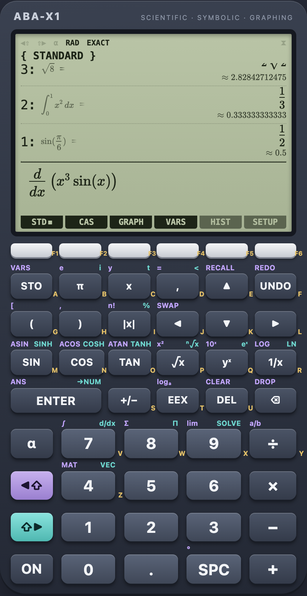
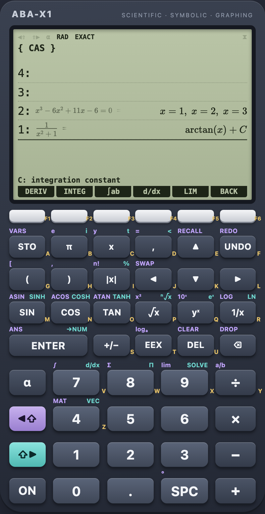
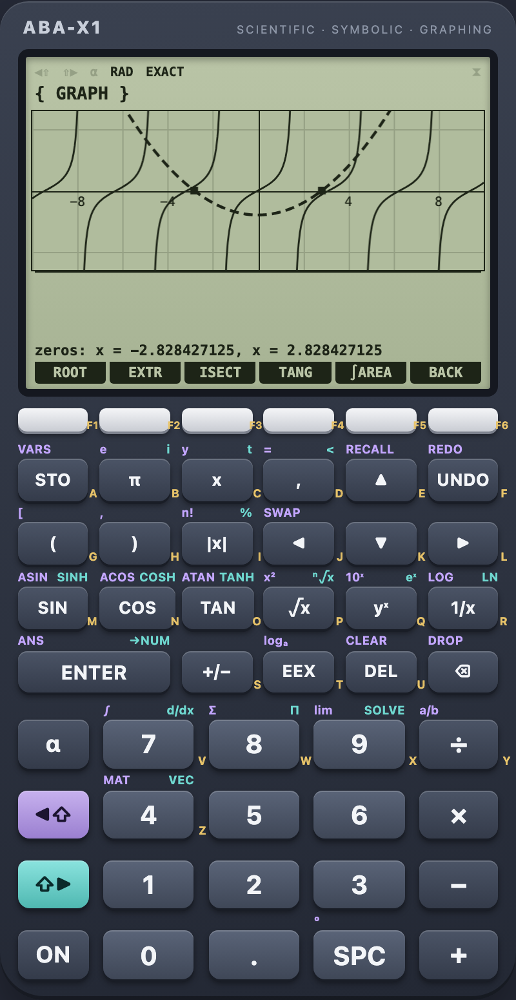
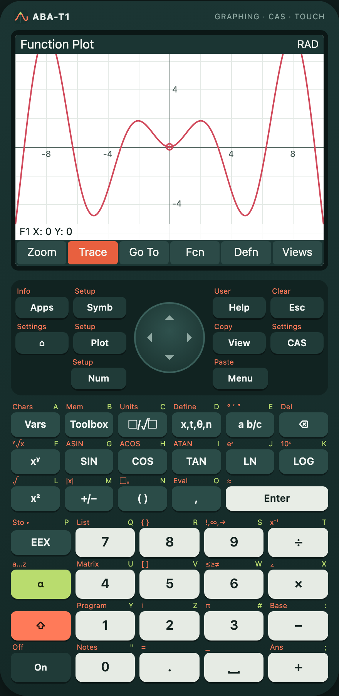
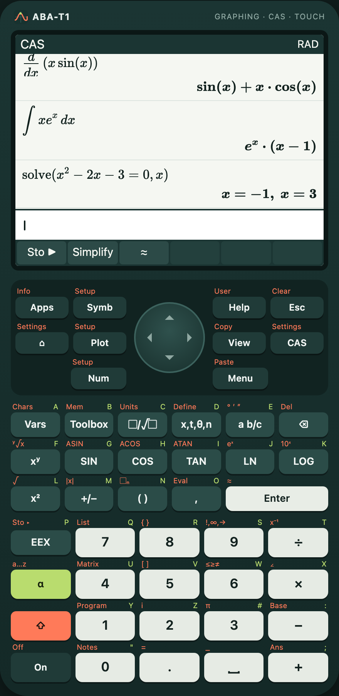
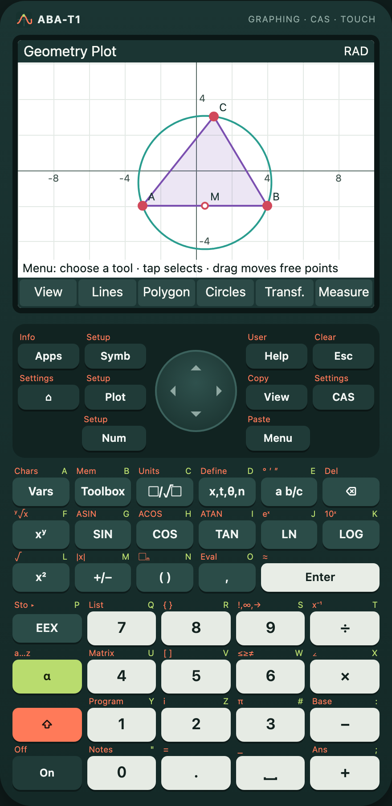
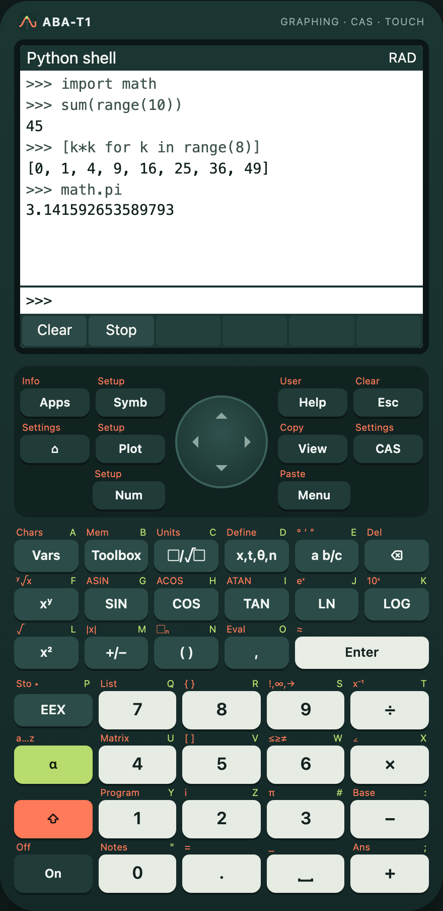

# ABA-X1

**Advanced Browser Algebra – Scientific & Symbolic Calculator**

A scientific calculator with a computer algebra system, textbook math notation and an interactive function plotter –
as a desktop app for **macOS, Windows and Linux** (Tauri 2) and as a **web app** that works offline, both built from
one Angular 22 code base. All mathematics runs locally in TypeScript, so desktop and web give the same results – and
every answer of the computer algebra system is checked numerically before it is shown.

<p align="center">
  
  
  
</p>

Worked examples (regenerated with `pnpm screenshots:examples`):
[8.5 · 88 · 1.19](docs/screenshots/examples/a-calculation.png) ·
[∫₀¹ sin(2x) dx exact, numeric and antiderivative](docs/screenshots/examples/b-integral.png) ·
[plot of sin((x−1)(x+2)) with zeros](docs/screenshots/examples/c-graph.png)

> **Downloads:** [GitHub releases](https://github.com/krocon/aba-x/releases/) · **Web app:**
> [krocon.de/products/aba-x1](https://krocon.de/products/aba-x1/) · **Product page:**
> [krocon.de/products/aba-x](https://krocon.de/products/aba-x/). See [`docs/roadmap.md`](docs/roadmap.md).

## Features

**Calculator** – a calculator device in the spirit of classic graphing calculators (own design): LCD with stack
levels, annunciators, soft menu and six softkeys, keypad with left/right shift functions and alpha letters.

- **Exact results** where possible (`1/3 + 1/6 = 1/2`, `√8 = 2√2`, `sin(π/6) = 1/2`, `∫₀¹ x² dx = 1/3`) with the
  decimal approximation underneath; →NUM for decimals; degrees or radians.
- **Natural input** (MathLive): fractions, roots, powers, integrals, derivatives, sums, limits, matrices.
- **RPN on demand**: operators and functions on an empty line work on the stack; ENTER duplicates, DROP, SWAP, browse
  the stack with ↑.
- **Every stack level shows input, exact result and decimal value**; click a level (or ↑ + Enter) to edit its input –
  ENTER replaces the level in place.
- **Variables and functions**: `a = 5`, `f(x) = x² − 3x + 2`, `f(a)`, STO, VARS menu – saved between sessions.

**CAS** (Nerdamer behind a verified adapter) – simplify, expand, factor, solve equations (also general solutions like
`x = π/6 + 2nπ`) and systems, derivatives (also partial and higher order), antiderivatives with `+ C`, definite and
improper integrals, limits. Results that fail the numerical spot check are not shown; non-elementary integrals and
non-existing limits are reported honestly.

**Graph** – up to six functions, LCD-style plot without false vertical lines at poles and jumps; zoom/pan with keys,
mouse, wheel and pinch; TRACE; zeros, extrema, intersections, tangent, signed area; export as PNG or SVG.

**Everywhere** – full hardware-keyboard support, history with favourites, export/import of all data (same file on
desktop and web), settings (angle, exact/decimal, digits, time limit, theme), English and German, native menu on the
desktop, installable offline web app (PWA), **full-size mode** (⤢ or `⌥F`) in which display and keypad fill the window.

## ABA-T1 – the second calculator

**ABA-T1** is a touch graphing calculator from the same code base (`apps/aba-t1`): a device with a touch display,
six menu buttons and a full keypad, plus the hardware keyboard. It runs the same math core and adds:

- **Home and CAS views** with textbook or algebraic entry, RPN, complex numbers, units, based integers, lists and
  matrices; a toolbox with every command and help in English and German.
- **Apps** (each with symbolic, plot and numeric views, setups and saved copies): Function, Parametric, Polar,
  Sequence, Advanced Graphing (relations with interval arithmetic), 3D Graphing, Linear/Quadratic/Trig Explorer,
  Statistics 1Var/2Var, Inference, Solve, Linear Solver, Finance, Triangle Solver, Spreadsheet, Geometry, Python.
- **Programming:** a structured calculator language (`@aba/ppl`) with an editor, debugger, user keys and app
  programs; **Python** via MicroPython in a worker.

<p align="center">
  
  
  
  
</p>

Run it with `pnpm --filter aba-t1 start` (web, port 1421) or `pnpm --filter aba-t1 exec tauri dev`; end-to-end tests
with `pnpm e2e --app aba-t1`, screenshots with `pnpm screenshots:t1`. User guide: [`docs/aba-t1.md`](docs/aba-t1.md);
product page: [`apps/aba-t1/site/`](apps/aba-t1/site/README.md).

## Keyboard

| Key                       | Action                                                                               |
| ------------------------- | ------------------------------------------------------------------------------------ |
| any character             | goes to the input line                                                               |
| `Enter` / `⇧Enter`        | ENTER / →NUM (decimal value)                                                         |
| `Esc`                     | clear the line, cancel a computation, leave the stack                                |
| `↑` on an empty line      | browse the stack (↑ ↓, Enter = edit, Delete = drop); click a level to edit it        |
| `F1`–`F6`                 | softkeys (mode menu: Standard, CAS, Graph, VARS, HIST, SETUP)                        |
| `⌥R` / `⌥E`               | radians ↔ degrees / exact ↔ decimal                                                  |
| `⌥F`                      | full size: display and keypad fill the window (landscape: keypad beside the display) |
| `⌥⌫` / `⌥S`               | DROP / SWAP                                                                          |
| `⌘/` · `⌘,` · `⌘S` · `⌘O` | shortcuts · settings · export · import (Ctrl on Windows/Linux)                       |
| Graph mode, empty line    | arrows pan (TRACE: move/switch), `+`/`−` zoom                                        |

## Development

Requirements: Node ≥ 22.22.3, pnpm 10, Rust stable (≥ 1.90) and the
[Tauri prerequisites](https://tauri.app/start/prerequisites/) of your OS.

```bash
pnpm install
pnpm start          # web version on http://localhost:1420
pnpm tauri dev      # desktop app
pnpm check          # versions, scripts, format, lint, unit tests, desktop + web build, Rust, licences
pnpm e2e            # web build in Chromium and WebKit: calculation, CAS, graph, typing, offline, axe
pnpm screenshots    # the images in docs/screenshots/
pnpm screenshots:examples   # worked examples in docs/screenshots/examples/
pnpm screenshots:site       # pictures of the product page in apps/aba-x1/site/img/
```

The repository is a monorepo for several calculators ([ADR 0007](docs/decisions/0007-monorepo-mehrere-rechner.md)):
`packages/math` (framework-free core), `packages/core` (shared Angular building blocks) and `apps/aba-x1` (this
app: Angular sources, Tauri crate, product page). Root commands work on ABA-X1; other apps via `--app <name>`.

More: [`CLAUDE.md`](CLAUDE.md) (commands, layout, rules), [`docs/architecture.md`](docs/architecture.md),
[`docs/technical-evaluation.md`](docs/technical-evaluation.md), [`docs/mathematics/`](docs/mathematics/),
[`docs/decisions/`](docs/decisions/), [`docs/release.md`](docs/release.md). The product page (static, no build step) is in
[`apps/aba-x1/site/`](apps/aba-x1/site/README.md). Development runs through feature
prompts in [`prompts/`](prompts/README.md).

## Licence

MIT (see [`LICENSE`](LICENSE)); third-party licences in [`apps/aba-x1/THIRD-PARTY-NOTICES.txt`](apps/aba-x1/THIRD-PARTY-NOTICES.txt)
and [`apps/aba-t1/THIRD-PARTY-NOTICES.txt`](apps/aba-t1/THIRD-PARTY-NOTICES.txt).
ABA-X1 is an independent project and not affiliated with any calculator manufacturer.
